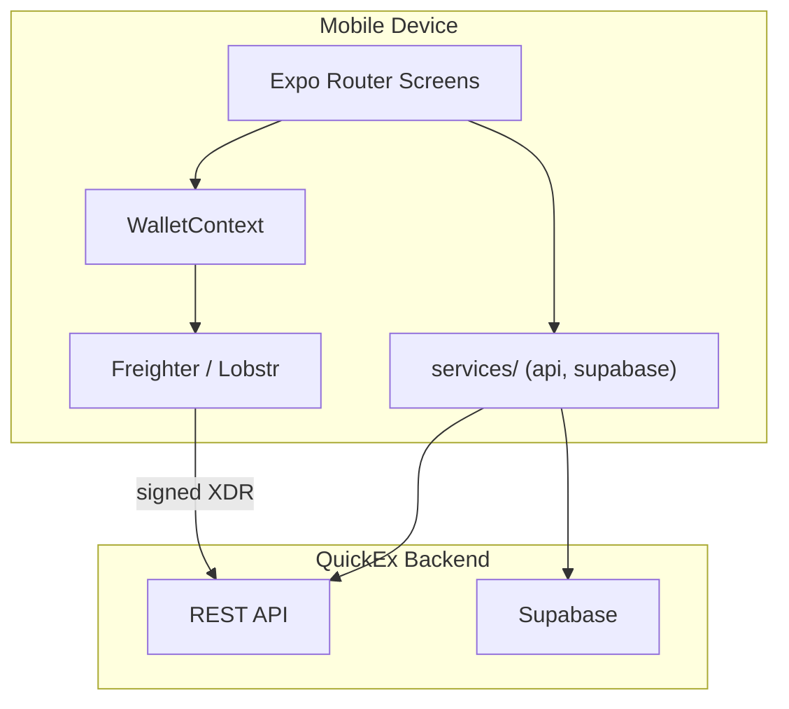
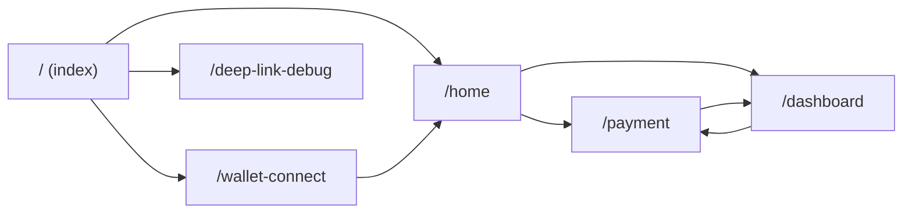
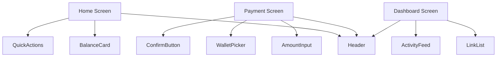
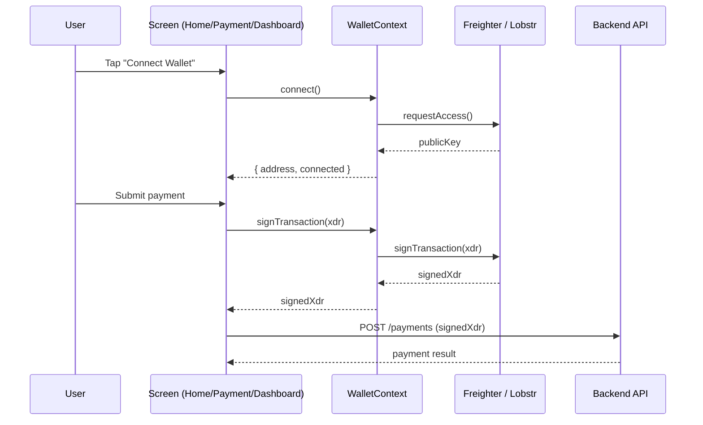

# Mobile App Architecture

This document describes the architecture of the QuickEx mobile app (`app/mobile`),
including the screen navigation flow, component hierarchy, wallet data flow, and
backend integration points.

## Overview

The mobile app is an Expo (React Native) application using Expo Router for
file-based navigation. It talks to the QuickEx backend over HTTP and integrates
with Stellar wallets (Freighter / Lobstr) for signing payment-link transactions.

## Screen Flow (Expo Router)

All routes live under `app/` and are file-based. The diagram below shows the
navigation transitions between the main routes.

| Route | Purpose |
|---|---|
| `/` | Landing / entry point. |
| `/wallet-connect` | Connect a Stellar wallet (Freighter / Lobstr). |
| `/home` | Main home screen with quick actions. |
| `/payment` | Create / pay a payment link. |
| `/dashboard` | Wallet activity and link overview. |
| `/deep-link-debug` | Debug screen for validating deep-link parsing. |

## Component Hierarchy

The three main screens compose shared UI components from `components/`.

## Wallet Data Flow

Wallet state is owned by `WalletContext` and consumed by screens via the
`useWallet` hook. The context is the single source of truth for the connected
address and signing capability.

## API Integration Points

| Screen / Service | Backend Endpoint | Notes |
|---|---|---|
| `services/api.ts` | `EXPO_PUBLIC_API_URL` | Base URL for all REST calls. |
| Home | `GET /links` | Recent payment links. |
| Payment | `POST /payments` | Submit a signed payment. |
| Dashboard | `GET /payments` | Wallet activity feed. |
| `services/supabase.ts` | `EXPO_PUBLIC_SUPABASE_URL` | Client-side reads via anon key. |

See `app/mobile/README.md` for the environment variables that configure these
integration points.
